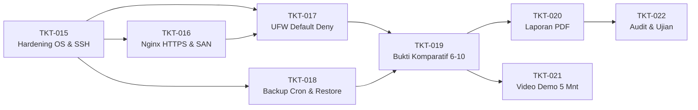

# Tutorial Ubuntu untuk Tugas Catatan Pribadi Terenkripsi ("CatatanSecure")

Panduan bertahap dan sistematis untuk **Nurul Hikmah (NIM: 230170187, Digit Terakhir: 7)**, berdasarkan dokumen tugas resmi dosen Keamanan Sistem Komputer dan repositori proyek [catatan_pribadi](https://github.com/nurulhikmah30nov-star/catatan_pribadi.git). Panduan ini memandu implementasi sisi infrastruktur Linux VM Ubuntu 24.04 LTS (TKT-015 s.d. TKT-023), pengujian 10 syarat keamanan (SEC-01 s.d. SEC-10), dan persiapan deliverable akademik.

> [!IMPORTANT]
> **Cara Mengikuti**: Kerjakan nomor langkah secara berurutan, satu blok perintah pada satu waktu. Setiap judul seperti `6.2.1` adalah nomor langkah terukur. Jangan mengulang langkah yang sudah terbukti selesai. Setiap kelompok bukti terminal wajib diawali dengan perintah identitas resmi: `whoami; date`.

---

## Peta Tugas Dosen: Sedang Mengerjakan Apa?

### Gambaran Tugas
Anda berperan sebagai **Security Engineer**: membangun aplikasi web mini di server Linux Ubuntu lalu mengamankannya secara menyeluruh. Digit terakhir NIM Anda adalah **7**, sehingga tema wajib Anda adalah **Catatan Pribadi**:
- **Aplikasi Web**: *CatatanSecure* (Laravel 12, PHP 8.3, SQLite 3, Tailwind CSS, Blade Heroicons).
- **Data Sensitif yang Di-enkripsi (Syarat 3 / SEC-03)**: **Isi konten catatan pribadi** (`content`) menggunakan algoritma simetris terotentikasi **AES-256-GCM** dengan format envelope `v1:nonce:ciphertext:tag`.
- **Data yang Dilindungi dari Akses Pengguna Lain (Syarat 10 / SEC-10)**: **Catatan pribadi antar-pengguna** melalui otorisasi *server-side* ketat (`NotePolicy` anti-IDOR). Pengguna biasa hanya boleh melihat dan mengelola catatannya sendiri; Administrator memiliki panel audit operasional dan manajemen pengguna.
- **Kolom Teks Bebas Uji XSS (Syarat 9 / SEC-09)**: **Komentar publik catatan** (`public_comment`) untuk membuktikan Stored XSS kondisi rentan vs aman.
- **Akun Uji Fiktif**: Minimal 2 akun pengguna (`nurul@catatan.local` dan `budi@catatan.local` dengan password fiktif sama untuk uji salt) dan 1 akun admin (`admin@catatan.local`).

---

### Sepuluh Syarat Keamanan yang Dinilai (8 Poin per Syarat = Total 80 Poin)

| Syarat Dosen | Objek yang Dikerjakan & Diamankan | Bukti yang Diminta | Rujukan Bab |
| :--- | :--- | :--- | :--- |
| **1 / SEC-01 — Tabel Risiko** | Identifikasi 5 aset utama & 5 risiko; jelaskan prinsip CIA (*Confidentiality, Integrity, Availability*) & kontrol mitigasi. | Tabel matriks risiko dan analisis risiko prioritas tertinggi di Laporan PDF. | Bab 10 & PRD Bab 4 |
| **2 / SEC-02 — Hashing Password** | Password disimpan sebagai hash adaptif lambat dengan salt otomatis (**bcrypt cost 12**); validasi batas 8–72 byte. | Kode Controller & 2 hash berbeda dari password identik `SamaPersis123!` (disensor parsial). | Bab 5 & Bab 9 |
| **3 / SEC-03 — Enkripsi AES-256-GCM** | Enkripsi isi catatan pribadi dengan nonce 12-byte unik, tag 16-byte, kunci di `.env` (`CIPHER_KEY`); dekripsi hanya untuk pemilik sah. | Cuplikan database ciphertext `v1:...`, tampilan dekripsi pengguna sah, kode service & `.gitignore`. | Bab 5, 8, & 9 |
| **4 / SEC-04 — HTTPS & TLS SAN** | Amankan komunikasi data web via HTTPS port 443 dengan sertifikat self-signed SAN (`catatan.local`), redirect HTTP port 80. | Tampilan gembok HTTPS di browser, detail sertifikat SAN, bukti port 80 redirect 301 ke 443. | Bab 6 |
| **5 / SEC-05 — Hardening Linux** | Gunakan operator non-root `nurul0187`, akun layanan `www-data` tanpa shell login, izin berkas `.env` (600), pengerasan daemon SSH. | Output `whoami`, `id www-data`, `ls -l .env`, konfigurasi `sshd_config.d` & servis aktif. | Bab 3, 4, & 5 |
| **6 / SEC-06 — Firewall UFW** | Kebijakan *default deny incoming*, izinkan hanya port esensial (22, 80, 443), bandingkan port sebelum vs sesudah. | Hasil scan Nmap dari host laptop sebelum/sesudah UFW aktif, tabel komparatif port. | Bab 7 |
| **7 / SEC-07 — Backup & Restore** | Backup database SQLite (via Online Backup API), unggahan, dan config; enkripsi OpenSSL, jadwal Cron, uji pemulihan. | Skrip backup, `crontab -l`, checksum SHA-256, dan **3 foto uji restore** (sebelum, setelah dihapus, setelah dipulihkan). | Bab 8 |
| **8 / SEC-08 — SQL Injection** | Buktikan pencarian rentan dimanipulasi dengan `' OR '1'='1' -- `, lalu buktikan versi aman menggunakan *Prepared Statements*. | Tangkapan layar hasil pencarian sebelum vs sesudah dengan input identik beserta cuplikan kode. | Bab 9 |
| **9 / SEC-09 — Cross-Site Scripting** | Buktikan payload `<script>alert('XSS')</script>` tereksekusi pada versi rentan, dan ter-escape aman pada Blade `{{ ... }}` versi aman. | Pop-up alert di browser pada versi rentan vs teks biasa pada versi aman, perbandingan Blade. | Bab 9 |
| **10 / SEC-10 — IDOR & Keamanan Sesi** | Buktikan User A bisa membuka catatan User B di versi rentan, dan ditolak (HTTP 403) di versi aman. Periksa flag cookie sesi. | Bukti akses silang sebelum (200 OK) vs sesudah (403 Forbidden), DevTools cookie `HttpOnly; SameSite=Lax; Secure`. | Bab 6 & Bab 9 |

---

### Hasil Akhir yang Wajib Dikumpulkan (Deliverables)
1. **Laporan PDF Resmi**: Format A4, font 11–12 pt, maksimal **6 halaman isi + 4 halaman lampiran bukti**. Berisi arsitektur, 10 syarat, risiko residual, refleksi, dan deklarasi AI.
2. **Repositori Kode / File ZIP**: Repositori GitHub [catatan_pribadi](https://github.com/nurulhikmah30nov-star/catatan_pribadi.git) (bersih tanpa `.env`, database aktif, atau private key).
3. **Video Demonstrasi**: Maksimal **5 menit**, resolusi $\ge$ 720p, menunjukkan aplikasi berjalan, perbandingan sebelum vs sesudah, dan narasi penjelasan suara asli mahasiswa.
4. **Sesi Tanya Jawab**: Ujian lisan individual (5–10 menit) menjelaskan kode kriptografi, logika otorisasi, dan pengerasan server.

---

## 1. Lingkungan Sistem dan Pagar Keamanan

### Parameter Lingkungan Kerja

| Parameter | Nilai / Konfigurasi |
| :--- | :--- |
| **Host Machine (Laptop Mahasiswa)** | macOS (atau Windows), Interface Host-Only (misal: `192.168.56.1/24` atau `192.168.136.1/24`) |
| **Target Guest OS (VM)** | Ubuntu 24.04 LTS Server, RAM $\ge 2$ GB |
| **IP VM Ubuntu (Host-Only)** | Contoh: `192.168.56.101` *(Sesuaikan dengan IP aktual dari `ip -br addr`)* |
| **Akun Operator VM** | `nurul0187` (Sesuai aturan dosen: nama depan + 4 digit NIM terakhir) |
| **Akun Layanan Web** | `www-data` (PHP 8.3 FPM & Nginx) dengan shell `/usr/sbin/nologin` |
| **Domain Lokal Aplikasi** | `catatan.local` (Diarahkan ke IP VM pada file `/etc/hosts` laptop klien) |
| **Path Aplikasi di Server** | `/var/www/catatan-pribadi` |
| **Repositori Resmi** | `https://github.com/nurulhikmah30nov-star/catatan_pribadi.git` |

### Pagar Keamanan Sebelum Memulai
1. **Wajib Snapshot VM**: Buat snapshot di VirtualBox/VMware/UTM sebelum langkah SSH (Snapshot 1: *Pre-Hardening*) dan sebelum Firewall (Snapshot 2: *Pre-Firewall*).
2. **Nol Rahasia di Laporan & Video (*Zero Plaintext Secrets*)**: Sensor nilai `APP_KEY`, `CIPHER_KEY`, hash password lengkap, dan token cookie pada seluruh tangkapan layar.
3. **Isolasi Versi Rentan**: Versi rentan **HANYA** boleh dijalankan di loopback `127.0.0.1:8001`. Dilarang membuka port 8001 ke antarmuka publik atau Nginx!

---

## 2. Urutan Pengerjaan Sesuai Tiket



---

## 3. Persiapan Server & Paket — TKT-015

### 3.1 Periksa Jaringan VM
Di terminal console Ubuntu:
```bash
whoami; date
ip -br addr
ip route
hostnamectl
```
Catat alamat IPv4 antarmuka Host-Only Anda (misal `192.168.56.101` atau `192.168.136.128`).

Dari terminal laptop (Mac / Windows PowerShell), uji koneksi ping:
```bash
ping -c 4 192.168.56.101
```

### 3.2 Buat Akun Operator `nurul0187`
Sesuai aturan format akun dosen (nama depan + 4 digit NIM):
```bash
sudo adduser nurul0187
sudo usermod -aG sudo nurul0187
su - nurul0187
whoami
```
*Pastikan output `whoami` menghasilkan `nurul0187`.*

Pastikan akun layanan `www-data` tidak memiliki shell interaktif:
```bash
getent passwd www-data
```
*Hasil wajib berakhiran `/usr/sbin/nologin` atau `/bin/false`.*

### 3.3 Instalasi Paket Kebutuhan
Sebagai `nurul0187`, perbarui repositori dan instal paket:
```bash
sudo apt update && sudo apt upgrade -y
sudo apt install -y nginx openssh-server php8.3-cli php8.3-fpm php8.3-sqlite3 php8.3-mbstring php8.3-xml php8.3-curl php8.3-zip sqlite3 composer git unzip openssl curl ufw cron nodejs npm
```

Verifikasi versi aplikasi:
```bash
whoami; date
php -v
nginx -v
sqlite3 --version
composer --version
sudo systemctl status nginx php8.3-fpm ssh cron --no-pager
```

Simpan daftar servis aktif untuk bukti SEC-05:
```bash
systemctl list-units --type=service --state=running
```

---

## 4. Konfigurasi SSH Key & Hardening Daemon SSH — TKT-015 / SEC-05

### 4.1 Buat Pasangan SSH Key di Laptop Host
Buka terminal di **laptop Anda (Mac Terminal / Windows PowerShell)**:
```bash
ssh-keygen -t ed25519 -f ~/.ssh/id_ed25519_catatan -C "nurul0187-catatan"
```
Tampilkan dan salin public key Anda:
```bash
cat ~/.ssh/id_ed25519_catatan.pub
```

### 4.2 Pasang Public Key pada VM Ubuntu
Di terminal **VM Ubuntu** sebagai user `nurul0187`:
```bash
mkdir -p ~/.ssh
chmod 700 ~/.ssh
nano ~/.ssh/authorized_keys
```
*Tempel satu baris public key yang disalin dari laptop, lalu simpan (`Ctrl+O`, `Enter`, `Ctrl+X`).*

Kunci izin berkas:
```bash
chmod 600 ~/.ssh/authorized_keys
```

### 4.3 Uji Login Berbasis Kunci dari Laptop Host
Buka jendela terminal baru di laptop Anda:
```bash
ssh -i ~/.ssh/id_ed25519_catatan -o PreferredAuthentications=publickey -o PasswordAuthentication=no nurul0187@192.168.56.101
```
*Pastikan Anda berhasil login tanpa memasukkan password Linux.*

### 4.4 Pengerasan Daemon SSH
Setelah login SSH key terbukti berhasil, terapkan konfigurasi pengerasan di VM Ubuntu:
```bash
sudo nano /etc/ssh/sshd_config.d/hardening.conf
```
Isi konfigurasi berikut:
```text
PermitRootLogin no
PasswordAuthentication no
PubkeyAuthentication yes
MaxAuthTries 3
X11Forwarding no
```
Simpan dan validasi sintaks:
```bash
sudo sshd -t
sudo sshd -T | grep -E 'permitrootlogin|passwordauthentication|pubkeyauthentication|maxauthtries'
```
Jika tidak ada error, terapkan:
```bash
sudo systemctl reload ssh
```

> [!NOTE]
> **[AMBIL FOTO BUKTI SEC-05-A]**: Tangkapan layar terminal VM memuat `whoami; date`, `id nurul0187`, `getent passwd www-data`, serta output `sudo sshd -T`.

---

## 5. Deploy Aplikasi CatatanSecure — TKT-015 / SEC-02 & SEC-03

### 5.1 Clone Repositori dan Pasang Dependensi
Di VM Ubuntu sebagai `nurul0187`:
```bash
sudo install -d -o nurul0187 -g www-data -m 750 /var/www/catatan-pribadi
cd /var/www/catatan-pribadi
git clone https://github.com/nurulhikmah30nov-star/catatan_pribadi.git .
composer install --no-dev --optimize-autoloader
npm ci
npm run build
```

### 5.2 Konfigurasi Environment & Kunci Enkripsi
Salin file konfigurasi:
```bash
cp .env.example .env
php artisan key:generate
```

Generate kunci enkripsi khusus AES-256-GCM (Syarat 3):
```bash
php artisan cipher:generate-key
```
*Salin nilai 64-karakter hex yang dihasilkan, lalu masukkan ke berkas `.env` pada variabel `CIPHER_KEY`.*

Edit berkas `.env`:
```bash
nano .env
```
Pastikan variabel berikut terisi:
```dotenv
APP_NAME=CatatanSecure
APP_ENV=production
APP_DEBUG=false
APP_URL=https://catatan.local

DB_CONNECTION=sqlite
DB_DATABASE=/var/www/catatan-pribadi/database/database.sqlite

CIPHER_KEY=MASUKKAN_64_HEX_HASIL_CIPHER_GENERATE_KEY
HASH_ROUNDS=12

SESSION_DRIVER=file
SESSION_LIFETIME=120
SESSION_COOKIE=catatan_secure_session
SESSION_SECURE_COOKIE=true
SESSION_COOKIE_HTTPONLY=true
SESSION_SAME_SITE=lax
```
Simpan file `.env`.

### 5.3 Inisialisasi Database SQLite & Seeder Akun Uji
```bash
touch database/database.sqlite
php artisan config:clear
php artisan migrate --force
php artisan db:seed --force
```

Periksa data seeder akun uji dan catatan:
```bash
sqlite3 database/database.sqlite "SELECT id, name, email, role FROM users;"
sqlite3 database/database.sqlite "SELECT id, user_id, title, substr(content, 1, 30) FROM notes;"
```
*Terlihat 3 akun: `admin@catatan.local`, `nurul@catatan.local`, `budi@catatan.local`, serta kolom `content` diawali dengan envelope `v1:...` (terenkripsi penuh).*

### 5.4 Pengetatan Hak Akses Berkas (Least Privilege)
```bash
sudo chown nurul0187:www-data /var/www/catatan-pribadi
sudo chmod 750 /var/www/catatan-pribadi

sudo chown www-data:www-data /var/www/catatan-pribadi/.env
sudo chmod 600 /var/www/catatan-pribadi/.env

sudo chown -R www-data:www-data /var/www/catatan-pribadi/storage /var/www/catatan-pribadi/bootstrap/cache /var/www/catatan-pribadi/database
sudo chmod -R 775 /var/www/catatan-pribadi/storage /var/www/catatan-pribadi/bootstrap/cache /var/www/catatan-pribadi/database
sudo chmod 664 /var/www/catatan-pribadi/database/database.sqlite

sudo -u www-data php artisan config:cache
sudo -u www-data php artisan route:cache
sudo -u www-data php artisan view:cache
```

> [!NOTE]
> **[AMBIL FOTO BUKTI SEC-02 & SEC-03]**:
> 1. Bukti SEC-02: Query SQL `SELECT email, password FROM users;` menampilkan dua hash bcrypt berbeda dari password yang sama `SamaPersis123!` (sensor 15 karakter tengah hash).
> 2. Bukti SEC-03: Query SQL `SELECT title, content FROM notes;` menampilkan string envelope `v1:nonce:ciphertext:tag` yang membuktikan isi catatan terenkripsi at-rest.

---

## 6. Web Server Nginx & HTTPS Sertifikat Self-Signed SAN — TKT-016 / SEC-04

### 6.1 Buat Sertifikat SSL Self-Signed dengan Ekstensi SAN
Di VM Ubuntu:
```bash
sudo mkdir -p /etc/nginx/tls
sudo openssl req -x509 -newkey rsa:2048 -sha256 -nodes -days 365 \
  -keyout /etc/nginx/tls/catatan.key \
  -out /etc/nginx/tls/catatan.crt \
  -subj '/CN=catatan.local' \
  -addext 'subjectAltName=DNS:catatan.local,DNS:localhost,IP:192.168.56.101'

sudo chmod 600 /etc/nginx/tls/catatan.key
sudo chmod 644 /etc/nginx/tls/catatan.crt
```
Verifikasi ekstensi SAN sertifikat:
```bash
sudo openssl x509 -in /etc/nginx/tls/catatan.crt -noout -subject -dates -ext subjectAltName
```

### 6.2 Konfigurasi Virtual Host Nginx
Buat file konfigurasi situs:
```bash
sudo nano /etc/nginx/sites-available/catatan
```
Isi konfigurasi berikut:
```nginx
# Server Block Port 80: Otomatis Redirect HTTP 301 ke HTTPS (DEC-06)
server {
    listen 80;
    listen [::]:80;
    server_name catatan.local 192.168.56.101;
    return 301 https://$host$request_uri;
}

# Server Block Port 443: TLS Termination HTTPS
server {
    listen 443 ssl;
    listen [::]:443 ssl;
    server_name catatan.local 192.168.56.101;
    root /var/www/catatan-pribadi/public;
    index index.php;

    ssl_certificate /etc/nginx/tls/catatan.crt;
    ssl_certificate_key /etc/nginx/tls/catatan.key;
    ssl_protocols TLSv1.2 TLSv1.3;
    ssl_ciphers HIGH:!aNULL:!MD5;

    location / {
        try_files $uri $uri/ /index.php?$query_string;
    }

    location = /index.php {
        include fastcgi_params;
        fastcgi_param SCRIPT_FILENAME $realpath_root$fastcgi_script_name;
        fastcgi_pass unix:/run/php/php8.3-fpm.sock;
    }

    location ~ \.php$ {
        return 404;
    }

    # Blokir akses berkas tersembunyi, env, dan file database
    location ~ /\.(?!well-known) { deny all; }
    location ~* \.(sqlite|sqlite3|db|bak|key|env)$ { deny all; }
}
```

Aktifkan konfigurasi dan nonaktifkan situs default:
```bash
sudo rm -f /etc/nginx/sites-enabled/default
sudo ln -s /etc/nginx/sites-available/catatan /etc/nginx/sites-enabled/catatan
sudo nginx -t
sudo systemctl reload nginx
sudo ss -ltnp | grep -E ':80|:443'
```

### 6.3 Pengaturan Host Laptop & Uji Browser
1. Di laptop Anda (Mac: `/etc/hosts` atau Windows: `C:\Windows\System32\drivers\etc\hosts`), tambahkan baris:
   ```text
   192.168.56.101 catatan.local
   ```
2. Dari terminal laptop, uji pengalihan HTTP 301:
   ```bash
   curl -I http://catatan.local/
   ```
   *Wajib merespons `HTTP/1.1 301 Moved Permanently` dengan header `Location: https://catatan.local/`.*
3. Buka browser dan akses **`https://catatan.local`**.
   - Buka DevTools (F12) $\rightarrow$ tab **Application** $\rightarrow$ **Cookies**.
   - Periksa cookie `catatan_secure_session`: pastikan centang `HttpOnly`, `Secure`, dan `SameSite=Lax`.

> [!NOTE]
> **[AMBIL FOTO BUKTI SEC-04]**:
> 1. Screenshot curl terminal `curl -I http://catatan.local/` menunjukkan status 301 redirect ke HTTPS.
> 2. Screenshot browser menampilkan halaman login CatatanSecure dengan detail sertifikat SSL (SAN `catatan.local` & IP VM) dan flag cookie sesi `HttpOnly; Secure; SameSite=Lax`.

---

## 7. Firewall UFW & Audit Port Nmap — TKT-017 / SEC-06

> [!CAUTION]
> Jangan menutup sesi terminal yang aktif saat menyalakan UFW untuk mencegah terkunci jika salah aturan.

### 7.1 Kondisi SEBELUM: Nyalakan Port Uji & Scan Nmap
Di VM Ubuntu, jalankan listener sementara di port 8080:
```bash
mkdir -p /tmp/ufw-test && cd /tmp/ufw-test
python3 -m http.server 8080 --bind 0.0.0.0
```
Biarkan perintah di atas tetap berjalan.

Dari terminal **laptop host**, lakukan audit Nmap kondisi SEBELUM:
```bash
nmap -Pn -p 22,80,443,8080 192.168.56.101
curl --connect-timeout 3 http://192.168.56.101:8080/
```
*Port 8080 terdeteksi **OPEN** dan curl berhasil terhubung.*

> [!NOTE]
> **[AMBIL FOTO SEC-06 SEBELUM]**: Screenshot Nmap dan curl dari laptop host menunjukkan port 8080 terbuka sebelum UFW aktif.

### 7.2 Kondisi SESUDAH: Terapkan Default-Deny UFW
Buka tab terminal baru di VM Ubuntu:
```bash
sudo ufw default deny incoming
sudo ufw default allow outgoing

# Izinkan SSH, HTTP (untuk redirect 301), dan HTTPS
sudo ufw allow 22/tcp comment 'SSH Management'
sudo ufw allow 80/tcp comment 'HTTP Redirect 301'
sudo ufw allow 443/tcp comment 'HTTPS Secure Traffic'

sudo ufw enable
sudo ufw status verbose
```

Dari terminal **laptop host**, ulangi audit Nmap kondisi SESUDAH (pastikan listener port 8080 di Ubuntu masih hidup):
```bash
nmap -Pn -p 22,80,443,8080 192.168.56.101
curl --connect-timeout 3 http://192.168.56.101:8080/
```
*Hasil: Port 22, 80, 443 berstatus **OPEN**, sedangkan port 8080 berstatus **FILTERED** dan curl mengalami timeout.* Hentikan listener python dengan `Ctrl+C`.

> [!NOTE]
> **[AMBIL FOTO SEC-06 SESUDAH]**: Screenshot terminal Ubuntu memuat `whoami; date` dan `sudo ufw status verbose`, berdampingan dengan scan Nmap dari laptop yang menunjukkan port 8080 berstatus *filtered*.

---

## 8. Backup Otomatis Terenkripsi & Uji Pemulihan (Restore) — TKT-018 / SEC-07

### 8.1 Buat Skrip Backup Terenkripsi
Di VM Ubuntu, siapkan direktori backup:
```bash
sudo mkdir -p /var/backups/catatan-pribadi /opt/scripts
```

Buat skrip backup:
```bash
sudo nano /opt/scripts/backup_catatan.sh
```
Masukkan skrip berikut:
```bash
#!/bin/bash
set -euo pipefail

BACKUP_DIR="/var/backups/catatan-pribadi"
DB_PATH="/var/www/catatan-pribadi/database/database.sqlite"
TIMESTAMP=$(date +"%Y%m%d_%H%M%S")
TEMP_DB="/tmp/dump_${TIMESTAMP}.sqlite"
ARCHIVE_TAR="/tmp/catatan_backup_${TIMESTAMP}.tar.gz"
ENCRYPTED_OUT="${BACKUP_DIR}/catatan_backup_${TIMESTAMP}.tar.gz.enc"
BACKUP_SECRET="RahasiaKunciCadanganCatatan2026!"

# 1. Gunakan SQLite Online Backup API (Aman meskipun aplikasi sedang melayani request)
sqlite3 "$DB_PATH" ".backup '$TEMP_DB'"
sqlite3 "$TEMP_DB" "PRAGMA integrity_check;" | grep -q "ok"

# 2. Kemas database dan storage upload
tar -czf "$ARCHIVE_TAR" -C /tmp "dump_${TIMESTAMP}.sqlite" -C /var/www/catatan-pribadi storage/app/public

# 3. Enkripsi arsip dengan OpenSSL AES-256-CBC
echo -n "$BACKUP_SECRET" | openssl enc -aes-256-cbc -salt -pbkdf2 -iter 100000 -pass stdin -in "$ARCHIVE_TAR" -out "$ENCRYPTED_OUT"

# 4. Hitung Checksum SHA-256
sha256sum "$ENCRYPTED_OUT" > "${ENCRYPTED_OUT}.sha256"

# Bersihkan file temporer
rm -f "$TEMP_DB" "$ARCHIVE_TAR"
echo "[SUCCESS] Backup terenkripsi dibuat: $ENCRYPTED_OUT"
```

Beri hak eksekusi dan kunci izin:
```bash
sudo chmod 700 /opt/scripts/backup_catatan.sh
sudo /opt/scripts/backup_catatan.sh
sudo ls -lh /var/backups/catatan-pribadi/
```

Jadwalkan di Crontab root (`sudo crontab -e`):
```cron
0 2 * * * /opt/scripts/backup_catatan.sh >> /var/log/backup_catatan.log 2>&1
```

### 8.2 Uji Pemulihan Bencana (Restore Test) 3 Foto Wajib

> [!IMPORTANT]
> Lakukan pengujian simulasi ini pada salinan database uji `/tmp/restore_test.sqlite` agar database operasional tetap aman!

```bash
# Siapkan salinan uji
cp /var/www/catatan-pribadi/database/database.sqlite /tmp/restore_test.sqlite
```

#### 📸 Foto 1: Kondisi SEBELUM Data Dihapus
```bash
whoami; date
sqlite3 /tmp/restore_test.sqlite "SELECT 'users', count(*) FROM users UNION ALL SELECT 'notes', count(*) FROM notes;"
```
*Hasil: `users|3`, `notes|6`.* **[AMBIL SCREENSHOT FOTO 1]**

#### 📸 Foto 2: Kondisi SETELAH Data Dihapus (Simulasi Bencana)
Hapus catatan milik Budi pada database uji:
```bash
sqlite3 /tmp/restore_test.sqlite "DELETE FROM notes WHERE user_id = 3;"
whoami; date
sqlite3 /tmp/restore_test.sqlite "SELECT 'users', count(*) FROM users UNION ALL SELECT 'notes', count(*) FROM notes;"
```
*Hasil: `users|3`, `notes|3`.* **[AMBIL SCREENSHOT FOTO 2]**

#### 📸 Foto 3: Kondisi SETELAH Dipulihkan dari Backup
Dekripsi arsip backup terbaru dan pulihkan data:
```bash
LATEST_BACKUP=$(ls -t /var/backups/catatan-pribadi/*.enc | head -n 1)
echo -n "RahasiaKunciCadanganCatatan2026!" | openssl enc -d -aes-256-cbc -pbkdf2 -iter 100000 -pass stdin -in "$LATEST_BACKUP" | tar -xz -C /tmp/

# Timpa kembali database uji dengan file hasil ekstrak
RESTORED_DUMP=$(ls -t /tmp/dump_*.sqlite | head -n 1)
cp "$RESTORED_DUMP" /tmp/restore_test.sqlite

whoami; date
sqlite3 /tmp/restore_test.sqlite "PRAGMA integrity_check;"
sqlite3 /tmp/restore_test.sqlite "SELECT 'users', count(*) FROM users UNION ALL SELECT 'notes', count(*) FROM notes;"
```
*Hasil: `ok`, lalu `users|3`, `notes|6` (data kembali utuh 100%).* **[AMBIL SCREENSHOT FOTO 3]**

---

## 9. Demonstrasi Versi Rentan vs Versi Aman (Syarat 8, 9, 10) — TKT-019

Jalankan server lab rentan terisolasi di terminal VM Ubuntu terpisah:
```bash
cd /var/www/catatan-pribadi
./scripts/run_vulnerable_demo.sh
```
*Aplikasi versi rentan berjalan di `http://127.0.0.1:8001/vuln`.*

### 9.1 Syarat 8: SQL Injection (Pencarian Catatan)
- **Kondisi Rentan (`http://127.0.0.1:8001/vuln/notes/search`)**:
  - Masukkan payload: `' OR '1'='1' -- `
  - **Hasil**: Kueri `SELECT * FROM notes WHERE title LIKE '%...%'` membocorkan seluruh catatan milik semua pengguna tanpa filter yang sah.
  - **[AMBIL FOTO SEC-08 SEBELUM]**
- **Kondisi Aman (`https://catatan.local/notes/search`)**:
  - Masukkan payload identik: `' OR '1'='1' -- `
  - **Hasil**: Sistem memperlakukan input sebagai string literal aman melalui parameter binding PDO. Ditampilkan kotak *empty state* "Tidak ada catatan ditemukan".
  - **[AMBIL FOTO SEC-08 SESUDAH]**

### 9.2 Syarat 9: Stored XSS (Komentar Publik Catatan)
- **Kondisi Rentan (`http://127.0.0.1:8001/vuln/notes/1`)**:
  - Masukkan komentar publik: `<script>alert('XSS-VULNERABLE')</script>`
  - **Hasil**: Komentar dirender mentah unescaped `{!! $note->public_comment !!}`, peramban mengeksekusi script dan memunculkan pop-up alert JavaScript.
  - **[AMBIL FOTO SEC-09 SEBELUM]**
- **Kondisi Aman (`https://catatan.local/notes/1`)**:
  - Masukkan payload identik: `<script>alert('XSS-VULNERABLE')</script>`
  - **Hasil**: Blade secara kontekstual meng-escape karakter HTML (`{{ $note->public_comment }}` menjadi `&lt;script&gt;...`), kode ditampilkan sebagai teks biasa tanpa dieksekusi.
  - **[AMBIL FOTO SEC-09 SESUDAH]**

### 9.3 Syarat 10: IDOR & Otorisasi Akses Catatan
- **Kondisi Rentan (`http://127.0.0.1:8001/vuln`)**:
  - Gunakan tombol switch ke akun **Nurul** (ID: 2).
  - Buka URL catatan milik **Budi** (ID: 4): `http://127.0.0.1:8001/vuln/notes/4`.
  - **Hasil**: Status **HTTP 200 OK**, catatan rahasia milik Budi terbuka bebas untuk Nurul karena tidak ada pengecekan kepemilikan data.
  - **[AMBIL FOTO SEC-10 SEBELUM]**
- **Kondisi Aman (`https://catatan.local/notes/4`)**:
  - Login sebagai **Nurul** (`nurul@catatan.local`).
  - Coba buka URL catatan milik **Budi** secara manual: `https://catatan.local/notes/4`.
  - **Hasil**: Sistem mencegat melalui `NotePolicy` dan melempar halaman **HTTP 403 Forbidden** (Akses Ditolak).
  - **[AMBIL FOTO SEC-10 SESUDAH]**

---

## 10. Checklist Pengumpulan & Ujian — TKT-020 s.d. TKT-022

### Checklist Kelengkapan Bukti (10/10 Syarat)
- [ ] **SEC-01**: Matriks tabel risiko CIA dan mitigasinya dimasukkan ke Laporan PDF.
- [ ] **SEC-02**: Foto 2 hash bcrypt berbeda dari password identik `SamaPersis123!` (tersensor).
- [ ] **SEC-03**: Foto ciphertext `v1:...` di database SQLite & dekripsi transparan pada browser pengguna berhak.
- [ ] **SEC-04**: Foto gembok HTTPS browser dengan sertifikat SAN `catatan.local` dan curl redirect 301.
- [ ] **SEC-05**: Foto identitas `whoami; date`, akun non-root `nurul0187`, `id www-data` nologin, dan hardening SSH.
- [ ] **SEC-06**: Foto Nmap sebelum (port 8080 open) vs sesudah UFW (port 8080 filtered).
- [ ] **SEC-07**: Tiga foto wajib restore SQLite (sebelum, setelah dihapus, setelah dipulihkan) + `crontab -l`.
- [ ] **SEC-08**: Foto SQLi bocor di port 8001 vs tertangani aman di HTTPS port 443.
- [ ] **SEC-09**: Foto pop-up alert XSS di port 8001 vs teks escaped di HTTPS port 443.
- [ ] **SEC-10**: Foto IDOR sukses (HTTP 200) di port 8001 vs ditolak (HTTP 403) di HTTPS port 443.

### Struktur Laporan PDF (Maksimal 6 Halaman Isi + 4 Halaman Lampiran)
- **Halaman 1**: Judul, Identitas (Nurul Hikmah / 230170187), Ringkasan Eksekutif, Diagram Arsitektur Jaringan.
- **Halaman 2**: Analisis Matriks Risiko Aset Catatan Pribadi (SEC-01).
- **Halaman 3**: Implementasi Kriptografi (SEC-02 Bcrypt Cost 12 & SEC-03 AES-256-GCM AEAD).
- **Halaman 4**: Pengerasan Linux Server, SSH, HTTPS Nginx, & Firewall UFW (SEC-04, SEC-05, SEC-06).
- **Halaman 5**: Prosedur Disaster Recovery & Backup Terenkripsi Cron (SEC-07).
- **Halaman 6**: Mitigasi OWASP Top 10 (SQLi, XSS, IDOR), Risiko Residual, Refleksi, dan Deklarasi AI.
- **Halaman 7–10 (Lampiran)**: Kompilasi bukti tangkapan layar beranotasi lengkap (10 syarat).

### Panduan Video 5 Menit
- **0:00 – 1:00**: Pembukaan identitas, arsitektur server, dan pengerasan OS/SSH (`whoami; date`).
- **1:00 – 2:00**: Akses HTTPS `catatan.local`, validasi cookie DevTools, demonstrasi hash bcrypt & ciphertext AES-256-GCM di database.
- **2:00 – 3:00**: Demonstrasi UFW dan bukti 3 foto restore disaster recovery.
- **3:00 – 4:30**: Pengujian komparatif SEBELUM vs SESUDAH pada lab rentan (8001) vs aman (443) untuk SQLi, Stored XSS, dan IDOR.
- **4:30 – 5:00**: Penutup, kesimpulan pertahanan berlapis, dan penjelasan keterbatasan sistem.

---

## 11. Troubleshooting Masalah Umum

| Masalah | Penyebab Umum | Solusi Cepat |
| :--- | :--- | :--- |
| **Tidak bisa ping / SSH ke VM** | Interface Host-Only belum satu subnet atau IP VM berubah. | Cek `ip -br addr` di console VM, sesuaikan IP pada perintah SSH. |
| **Nginx HTTP 502 Bad Gateway** | Layanan PHP-FPM belum berjalan atau path socket salah. | Jalankan `sudo systemctl restart php8.3-fpm` dan cek `ls /run/php/`. |
| **Sertifikat SSL Tidak Dipercaya** | Sertifikat self-signed belum di-import ke keychain browser. | Import file `catatan.crt` ke Keychain Access (Mac) atau Certificate Manager (Windows) dan set *Always Trust*. |
| **SQLi / XSS / IDOR versi rentan tidak jalan** | Database rentan belum diseed atau salah file environment. | Jalankan `php artisan --env=vulnerable migrate:fresh --seed --force` dan pastikan script `./scripts/run_vulnerable_demo.sh` aktif di port 8001. |
| **Terkunci keluar dari SSH setelah UFW aktif** | Port 22 lupa diizinkan sebelum `ufw enable`. | Buka console VM di VirtualBox/VMware, ketik `sudo ufw allow 22/tcp` dan periksa `sudo ufw status`. |
